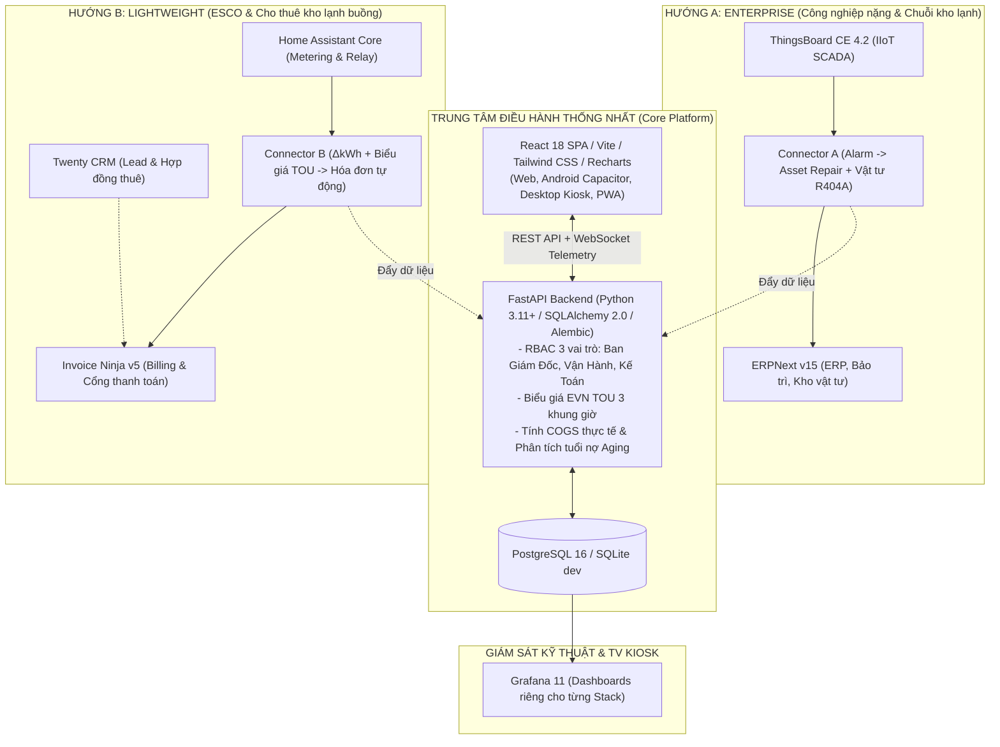

# ❄️⚡ THERMAL & BUSINESS EXECUTIVE COMMAND CENTER
### Hệ Thống Điều Hành Doanh Nghiệp Liên Ngành: Quản Trị Kinh Doanh × Kỹ Thuật Nhiệt

ThermalBiz Command Center là nền tảng điều hành thống nhất kết nối giữa **Hệ thống Nhiệt Lạnh Công Nghiệp** (Kho đông sâu, hầm cấp đông, Chiller, lò hơi) và **Hoạt động Kinh doanh & Tài chính** (Doanh thu, COGS toàn diện, biểu giá EVN 3 khung giờ, quản trị công nợ và cảnh báo an toàn thực phẩm HACCP).

---

## 🏛️ KIẾN TRÚC TỔNG THỂ HỆ THỐNG

ThermalBiz triển khai theo kiến trúc **Trung tâm Điều phối Thống nhất (Core Platform)** kết hợp cùng hai hướng tích hợp mở rộng nguồn mở:



---

## 📦 CÁC THÀNH PHẦN NỀN TẢNG (STACK COMPONENTS)

| Phân hệ | Công nghệ | Thư mục mã nguồn | Trách nhiệm chính |
| :--- | :--- | :--- | :--- |
| **Backend API** | FastAPI, SQLAlchemy 2, Alembic, Pydantic v2 | `backend/` | RESTful API, WebSocket thời gian thực, xác thực JWT, RBAC 3 vai trò (BGD, Vận hành, Kế toán), tính toán điện TOU, HACCP compliance. |
| **Frontend SPA** | React 18, Vite, TypeScript, Tailwind, Recharts | `frontend/` | Giao diện buồng lái điều hành (Overview, Thermal, Business, Alerts), chỉ báo độ trễ dữ liệu (`LiveBadge`), tự động reconnect WebSocket. |
| **Multi-Platform** | Capacitor, PWA Service Worker, Kiosk Scripts | `frontend/android/`, `clients/` | Ứng dụng Android APK native, Progressive Web App (offline caching), và chế độ Edge/Chrome Kiosk toàn màn hình cho TV điều hành. |
| **Connector A** | FastAPI Event Bridge | `connectors/thingsboard-to-erpnext/` | Bắt alarm IoT từ ThingsBoard, tạo `Asset Repair` (doctype thật của ERPNext v15) với `asset` tra từ bảng ánh xạ `DEVICE_ASSET_MAP`, khai báo vật tư gas R404A trong child table `stock_items`, chống lặp phiếu bằng cooldown lưu trên đĩa. |
| **Connector B** | FastAPI Billing Bridge | `connectors/ha-to-invoiceninja/` | Đọc **chỉ số tích lũy** từ công tơ, giao backend tính $\Delta kWh$ và phân bổ 3 khung giờ EVN, dịch kết quả thành line items Invoice Ninja, rồi ghi ngược `external_invoice_id` về backend làm khóa idempotency bền vững. Kèm Dead-Letter Queue. |
| **Grafana Dashboards** | Grafana Provisioning | `grafana/` | Cung cấp 3 dashboard độc lập (`app`, `enterprise`, `lightweight`) tối ưu cho màn hình TV Kiosk. |

---

## ⚙️ YÊU CẦU TIÊN QUYẾT (PREREQUISITES)

- **Hệ điều hành:** Windows 10/11, macOS, hoặc Linux.
- **Docker Desktop:** Khuyến nghị cấp tối thiểu **4 GB RAM** (nếu chạy Stack A ERPNext/ThingsBoard khuyến nghị **8 GB RAM**).
- **Python:** 3.11 hoặc 3.12 (để chạy môi trường dev và test suite).
- **Node.js:** v20.x trở lên cùng `npm`.

---

## 🚀 HƯỚNG DẪN KHỞI CHẠY NHANH (QUICK START)

### 1. Chuẩn bị môi trường & Biến cấu hình
Tạo file `.env` từ file mẫu `.env.example`:
```powershell
Copy-Item .env.example .env
```
Kiểm tra tính toàn vẹn cấu hình (không cần Docker):
```powershell
.\run.ps1 -Action Check
```

### 2. Khởi chạy Ứng dụng Chính (Khuyến nghị bắt đầu từ đây)
Khởi chạy stack ứng dụng cốt lõi (FastAPI Backend + PostgreSQL + Grafana):
```powershell
.\run.ps1 -Action App
```
- **Backend API Docs:** [http://localhost:8080/docs](http://localhost:8080/docs)
- **Frontend SPA (Dev):** [http://localhost:5173](http://localhost:5173) (chạy `npm run dev` trong `frontend/`)
- **Grafana App Dashboard:** [http://localhost:3000](http://localhost:3000) (User: `admin` / Password trong `.env`)

### 3. Tài khoản Demo có sẵn (Seed Data)
| Tên đăng nhập | Mật khẩu mặc định | Vai trò (Role) | Quyền hạn |
| :--- | :--- | :--- | :--- |
| `bgd` | `ThermalBiz2026!` | Ban Giám Đốc | Toàn quyền xem tài chính, kỹ thuật, duyệt chi và cấu hình hệ thống. |
| `vanhanh` | `ThermalBiz2026!` | Vận Hành | Giám sát kỹ thuật nhiệt, trạng thái thiết bị, xác nhận/đóng cảnh báo. |
| `ketoan` | `ThermalBiz2026!` | Kế Toán | Quản trị doanh thu, chi phí điện, công nợ khách hàng và xuất hóa đơn. |

---

## 🏭 KHỞI CHẠY CÁC STACK MỞ RỘNG (ENTERPRISE / LIGHTWEIGHT)

### Hướng A: Công nghiệp nặng (ThingsBoard + ERPNext)
```powershell
.\run.ps1 -Action Enterprise
```
- **ThingsBoard IIoT:** [http://localhost:8083](http://localhost:8083)
- **ERPNext v15:** [http://localhost:8000](http://localhost:8000)
- **Connector A Webhook:** [http://localhost:8081/health](http://localhost:8081/health)

### Hướng B: ESCO & Cho thuê kho (Home Assistant + Invoice Ninja + Twenty)
```powershell
.\run.ps1 -Action Lightweight
```
- **Home Assistant:** [http://localhost:8123](http://localhost:8123)
- **Invoice Ninja v5:** [http://localhost:8088](http://localhost:8088)
- **Twenty CRM:** [http://localhost:3002](http://localhost:3002)
- **Grafana ESCO:** [http://localhost:3001](http://localhost:3001)
- **Connector B API:** [http://localhost:8082/health](http://localhost:8082/health)

### Mở Màn hình TV Kiosk Toàn Màn hình
```powershell
.\run.ps1 -Action Kiosk
```

### Dừng Tất cả các Container
```powershell
.\run.ps1 -Action Stop
```

---

## 🧪 KIỂM THỬ TỰ ĐỘNG & BẢO ĐẢM CHẤT LƯỢNG (TEST SUITE)

Dự án duy trì bộ kiểm thử tự động toàn diện với tỷ lệ pass 100%:

```powershell
# 1. Kiểm thử Backend (223 tests)
.\.venv\Scripts\pytest backend\tests -q

# 2. Kiểm thử Connectors & Bảo mật Ingest (69 tests)
.\.venv\Scripts\pytest connectors\tests -q

# 3. Kiểm thử Frontend Vitest (82 tests)
npm --prefix frontend test -- --run

# 4. Kiểm tra TypeScript Type Check
npm --prefix frontend run build
```

---

## 📁 CẤU TRÚC THƯ MỤC DỰ ÁN

```
thermal-biz-command-center/
├── .github/workflows/          # CI/CD pipelines (Backend test với Postgres 16 thật, Frontend Vitest, PWA/Android build)
├── architecture/               # Hồ sơ thiết kế kiến trúc chi tiết Hướng A & Hướng B
├── backend/                    # FastAPI Backend
│   ├── alembic/                # Database migrations
│   ├── app/                    # Models, Routers, Services (billing, thermal, finance, ingest)
│   └── tests/                  # Pytest test suite (223 tests)
├── connectors/                 # Event & Metering Bridges
│   ├── thingsboard-to-erpnext/ # Connector A: ThingsBoard -> ERPNext Asset Repair
│   ├── ha-to-invoiceninja/     # Connector B: HA -> Backend billing -> Invoice Ninja
│   └── tests/                  # Connector test suite, gồm cả luồng thật (69 tests)
├── database/                   # Khởi tạo SQL & Seed scripts
│   └── migrations/             # Tách riêng PostgreSQL và MariaDB dialects
├── docker/                     # Docker Compose cho các stack mở rộng (enterprise, lightweight)
├── frontend/                   # React 18 SPA + Capacitor Android + PWA
│   ├── src/                    # Components, Pages, Store, WebSocket hooks
│   └── android/                # Native Android Capacitor Project
├── grafana/                    # Provisioning YAML & JSON Dashboards cho 3 stack
├── clients/                    # Hướng dẫn kết nối mobile/desktop & Kiosk launch scripts
├── run.ps1                     # Orchestrator điều khiển tự động toàn bộ hệ thống
└── docker-compose.yml          # Compose stack ứng dụng chính
```

---

## 🔒 BẢO MẬT & TUÂN THỦ DỮ LIỆU
- **JWT & Password Security:** Mật khẩu người dùng được băm an toàn bằng `bcrypt`. Token JWT mang thời hạn hợp lệ cụ thể với thuật toán mã hóa HS256.
- **Header Authentication:** Toàn bộ webhook và API endpoint trung gian bắt buộc có header `X-Connector-API-Key`.
- **An toàn Ingest:** Ngăn chặn tuyệt đối việc client tự khai đơn giá điện hay client_id tùy ý; toàn bộ đơn giá được quyết định tại server.
- **Tiêu chuẩn An toàn Thực phẩm:** Giám sát liên tục ngưỡng HACCP cho toàn bộ kho lạnh nhiệt độ âm sâu với thời gian phản hồi cảnh báo tức thì.
