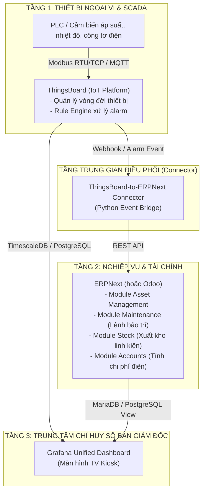

# KIẾN TRÚC HƯỚNG A: DOANH NGHIỆP CÔNG NGHIỆP & CHUỖI KHO LẠNH
## ThingsBoard (IIoT) $\times$ ERPNext (ERP & Bảo trì) $\times$ Grafana (Chỉ huy số)
*(Có thể thay thế ERPNext bằng Odoo khi cần hệ sinh thái App mở rộng)*

---

## 1. MỤC TIÊU & BỐI CẢNH ỨNG DỤNG
Dành cho các **Nhà máy sản xuất, Nhà máy chế biến thủy hải sản, Chuỗi kho lạnh bảo quản lớn, Trạm cấp nhiệt / Lò hơi công nghiệp**:
- Quản trị thiết bị công nghiệp nặng (Máy nén trục vít, Tháp giải nhiệt, Lò hơi đốt than/biomass, Dàn ngưng tụ).
- Khối lượng dữ liệu cảm biến lớn (hàng nghìn điểm đo mỗi giây qua Modbus RTU/TCP, PLC Siemens/Mitsubishi).
- Nhu cầu quản lý chuỗi cung ứng, kho vật tư thay thế (spare parts), khấu hao tài sản và kế toán giá thành chuyên sâu.

---

## 2. PHÂN CÔNG VAI TRÒ CÁC NỀN TẢNG MÃ NGUỒN MỞ

---

## 3. CƠ CHẾ VẬN HÀNH THỰC TẾ

1. **Thu thập dữ liệu Kỹ thuật Nhiệt:**
   - Cảm biến áp suất hút ($P_o$), áp suất đẩy ($P_k$), nhiệt độ môi chất và điện năng máy nén đẩy liên tục về **ThingsBoard** qua giao thức MQTT.
   - ThingsBoard tính toán thời gian thực hệ số làm lạnh:
     $$COP = \frac{Q_o}{N_e}$$
2. **Kích hoạt Bảo trì Tự động (Predictive Maintenance):**
   - Khi $COP < 3.2$ trong 30 phút liên tục (nghi ngờ thiếu gas lạnh hoặc bám bẩn dàn ngưng) HOẶC độ rung động cơ $> 4.5\,\text{mm/s}$:
   - **ThingsBoard Rule Engine** kích hoạt Alarm $\rightarrow$ Gửi Webhook sang `thingsboard-to-erpnext connector`.
   - Connector gọi REST API của **ERPNext** để:
     - Tạo ngay một **Phiếu sửa chữa tài sản (`Asset Repair`)** — ERPNext không có doctype `Maintenance Request` (đó là của Odoo). `Asset Repair` bắt buộc field `asset` là Link tới một Asset có thật, nên connector phải tra bảng ánh xạ `DEVICE_ASSET_MAP` (device ThingsBoard → Asset ERPNext) do người vận hành khai báo; thiết bị chưa có trong bảng thì bị từ chối (422) chứ không đoán bừa.
     - Khai báo 2 bình gas lạnh R404A dự phòng ngay trong child table `stock_items` của phiếu (field `consumed_quantity` là kiểu chuỗi trong ERPNext). Không dùng `Stock Reservation Entry` riêng: `voucher_type` của doctype đó là Select chỉ chấp nhận `Sales Order`, nên không thể gắn vào một phiếu sửa chữa.
     - *Chưa nối dây:* gửi email/thông báo giao việc cho kỹ sư trưởng. Hiện phiếu dừng ở trạng thái `Pending` để kỹ sư trưởng tự nhận việc trên ERPNext.
3. **Hiển thị Hợp nhất trên Grafana:**
   - Grafana kết nối trực tiếp database của Thingsboard và ERPNext:
     - Khối trái: Doanh thu lưu kho & Chi phí tiền điện vận hành (lấy từ ERPNext).
     - Khối giữa: Công nợ khách hàng theo tuổi nợ (lấy từ ERPNext).
     - Khối phải: Đường cong nhiệt độ kho âm sâu và chỉ số $COP$ từng máy nén (lấy từ ThingsBoard).

---

## 4. PHƯƠNG ÁN THAY THẾ ODOO
Nếu doanh nghiệp của anh ưu tiên hệ sinh thái module thương mại và POS:
- Thay `ERPNext` bằng `Odoo`.
- Module Odoo cần kích hoạt: `mrp_maintenance` (Bảo trì), `stock` (Kho), `account` (Kế toán).
- Cơ chế kết nối giữa ThingsBoard và Odoo hoàn toàn tương tự thông qua XML-RPC hoặc Odoo JSON-RPC API.
