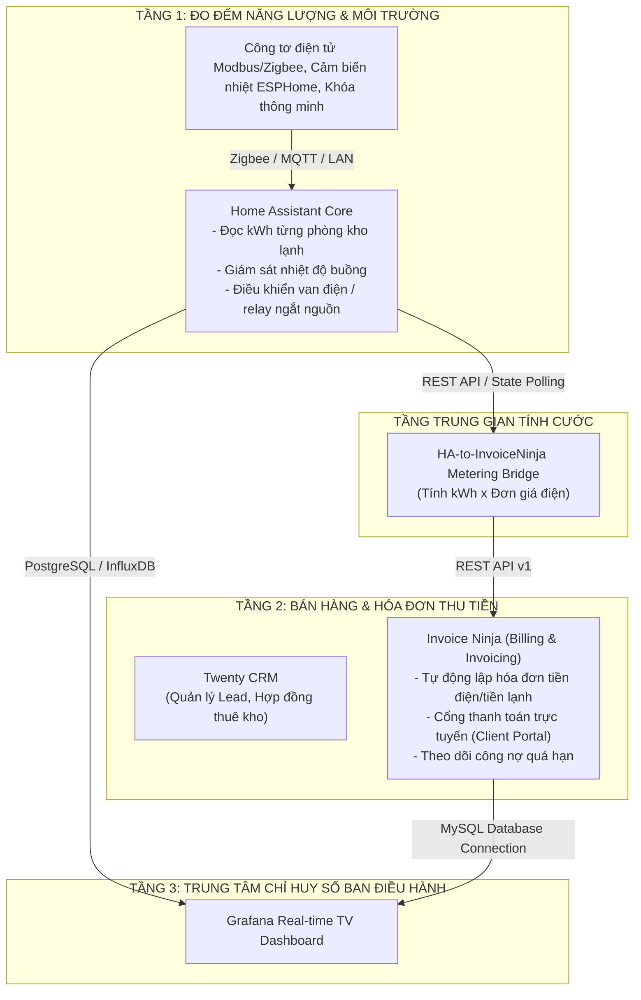

# KIẾN TRÚC HƯỚNG B: DỊCH VỤ NĂNG LƯỢNG TINH GỌN & CHO THUÊ KHO LẠNH (ESCO)
## Home Assistant (Local IoT) $\times$ Twenty (CRM) $\times$ Invoice Ninja (Billing) $\times$ Grafana
*(Tận dụng hệ sinh thái Client đa nền tảng Flutter có sẵn: Windows .exe, Linux, Android, iOS)*

---

## 1. MỤC TIÊU & BỐI CẢNH ỨNG DỤNG
Dành cho **Mô hình Dịch vụ Năng lượng (ESCO), Cho thuê phòng kho lạnh, Tòa nhà thương mại cho thuê điều hòa Chiller, Co-working / Bất động sản**:
- Cần đo đếm điện năng tiêu thụ ($kWh$) và nhiệt độ buồng lạnh cho từng khách thuê độc lập.
- Nhu cầu cốt lõi là **Lập hóa đơn tự động theo sản lượng tiêu thụ thực tế (Usage-based & Recurring Billing)** và thu hồi công nợ nhanh chóng.
- Đội ngũ quản lý cần ứng dụng di động (iOS, Android) và Desktop (.exe, Linux) gọn nhẹ, trực quan, không cồng kềnh như ERP truyền thống.

---

## 2. PHÂN CÔNG VAI TRÒ CÁC NỀN TẢNG MÃ NGUỒN MỞ

---

## 3. CƠ CHẾ VẬN HÀNH THỰC TẾ

1. **Khách hàng ký hợp đồng:**
   - Nhân viên kinh doanh tạo khách hàng và hợp đồng thuê kho trên **Twenty CRM**.
   - Dữ liệu khách hàng tự động đồng bộ sang **Invoice Ninja**.
2. **Đo đếm chỉ số điện & nhiệt:**
   - **Home Assistant** đọc công tơ điện thông minh đo lường điện năng tiêu thụ ($kWh$) cho từng kho lạnh của từng khách hàng.
3. **Xuất hóa đơn theo sản lượng (Usage-based Billing):**
   - `ha-to-invoiceninja connector` được **gọi theo yêu cầu** qua `POST /api/generate-invoice` (kèm tenant, entity của công tơ và kỳ lập hoá đơn). **Repo hiện chưa có scheduler/cron nào** — muốn chạy định kỳ ngày 25 hàng tháng thì người vận hành phải tự thêm tác nhân kích hoạt, ví dụ một Automation của Home Assistant hoặc cron trên máy chủ.
   - Connector đọc **chỉ số tích lũy** của công tơ từ Home Assistant, rồi gửi chỉ số đó lên **backend ThermalBiz**. Backend mới là nơi quyết định đơn giá: tính $\Delta kWh$ giữa hai lần đọc (thiếu mốc kỳ trước thì **báo lỗi chứ không đoán**), chia sản lượng theo 3 khung giờ giá điện EVN (cao điểm / bình thường / thấp điểm), cộng thêm phí dịch vụ bảo quản lạnh:
     $$\text{Tổng tiền} = \sum_{\text{khung giờ}} kWh_{\text{khung}} \times \text{Giá}_{\text{khung}} + \Delta kWh \times \text{Phí dịch vụ/kWh}$$
   - Connector chỉ **dịch kết quả đó** thành các dòng hoá đơn (`line_items`) của Invoice Ninja — một dòng cho mỗi khung giờ giá điện và một dòng phí dịch vụ — rồi gọi `POST /api/v1/invoices`.
   - Sau khi tạo xong, connector **ghi ngược ID hoá đơn Invoice Ninja** về backend (`external_invoice_id`). Cột này là khóa chống xuất trùng bền vững: nó nằm trong database nên sống qua việc container khởi động lại, khác với file JSON tạm trong connector. Kỳ nào đã xuất rồi thì gọi lại chỉ nhận được hoá đơn cũ.
   - *Chưa nối dây:* gửi link thanh toán qua email cho khách. Việc đó thuộc về tính năng gửi hoá đơn của chính Invoice Ninja (Client Portal / email template), không phải connector này.
4. **Xử lý trễ hạn & Điều khiển phần cứng (Local Automation):**
   - Khách hàng có thể tra cứu hóa đơn và thanh toán online qua Client Portal của Invoice Ninja.
   - Nếu hóa đơn quá hạn $> 15$ ngày và khách không phản hồi $\rightarrow$ Invoice Ninja bắn webhook về Home Assistant kích hoạt còi cảnh báo hoặc tạm khóa quyền truy cập kho lạnh qua mã khóa cửa số.
5. **Màn hình Chỉ huy TV:**
   - Grafana hiển thị tổng doanh số cho thuê kho, tổng tiền điện EVN phải trả, tỷ lệ thanh toán đúng hạn và nhiệt độ của từng kho hàng.

---

## 4. BẢN QUYỀN & HỆ SINH THÁI CLIENT CÓ SẴN (WINDOWS, LINUX, ANDROID, IOS)
Điểm vượt trội của Hướng B là **không cần lập trình lại ứng dụng Client**:
- **Invoice Ninja** được xây dựng bằng **Flutter**: Cung cấp app native có sẵn cho Windows (`.exe`), Linux, Android (`.apk`), và iOS trên App Store.
- **Home Assistant** cung cấp app native chính thức: `Home Assistant Companion` hỗ trợ đầy đủ Windows, Android, iOS.
- **Grafana** hỗ trợ app di động chính thức trên Android/iOS và chế độ TV Kiosk trên PC.
